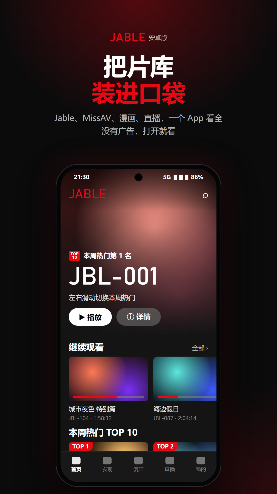
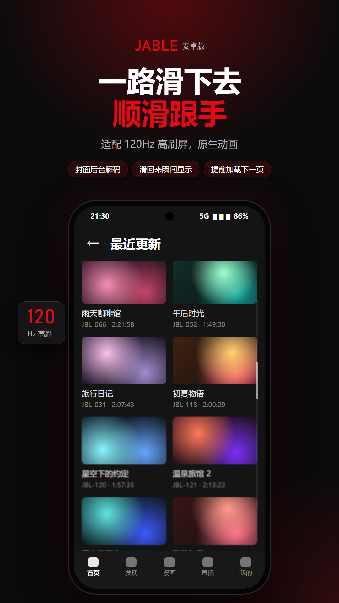
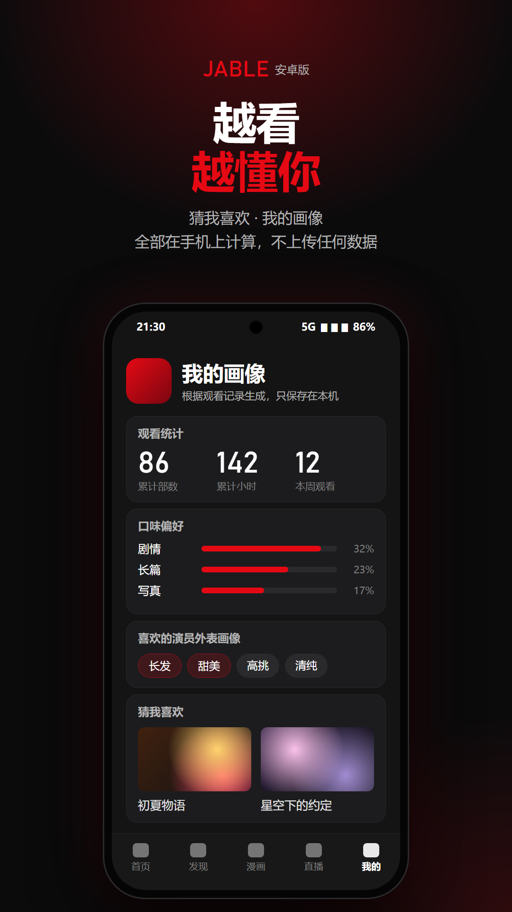

# Jable · Android

> 仅限 18 岁以上成年人。使用前请先阅读文末的[免责声明](#免责声明)。

一个个人自用的影片浏览 / 播放客户端：把 Jable、MissAV 的影片，以及 Netflav、AV01、R18.dev 的作品资料整合到一个干净、无广告的界面里。用 .NET MAUI（C#）写成，针对高刷新率屏幕做了列表滑动优化。

Windows 版见 [Jable](https://github.com/QkzzZzZz/Jable)。

| | | |
|---|---|---|
|  |  |  |

<sub>宣传图里的封面、标题、番号和数据都是示意，不是真实内容。</sub>

## 功能

- **首页**：大图轮播、继续观看、最近更新、本周热门 TOP 10、新片上市，滚到底自动加载
- **发现**：搜索、分类、标签、演员、MissAV 栏目
- **漫画 / 直播**
- **播放**：站内页面播放，带续播
- **下载**：后台下载，存到本地
- **我的**：观看记录、片单、观看画像与「猜我喜欢」
- **流畅**：原生动画、图片后台解码与缓存、固定尺寸卡片、AOT 提前编译、自动使用屏幕最高刷新率

## 安装

到 [Releases](../../releases) 下载 `Jable-Android-<版本>.apk` 安装。只支持 64 位 ARM 手机（近几年的手机基本都是），Android 7.0 及以上（低版本系统未实测）。

## 从源码编译

需要 .NET 10 SDK（含 `maui-android` 工作负载）、JDK 17、Android SDK。把三者放在同一个目录下：

```
<工具目录>\dotnet\         .NET 10 SDK
<工具目录>\jdk17\          JDK 17
<工具目录>\android-sdk\    Android SDK
```

默认工具目录是 `%USERPROFILE%\AndroidDev`，也可以用环境变量 `JABLE_ANDROID_DEV` 指定。然后：

```powershell
.\build.ps1 emulator   # 模拟器调试版（快，不签名）
.\build.ps1 release    # 正式安装包 → release\
.\build.ps1            # 给 Android Studio「Profile or Debug APK」用（手机 + 模拟器两种 CPU）→ android-studio\
```

`release` 和默认模式需要签名密钥：在工具目录下放 `jable-release.keystore`（别名 `jable`）和保存密码的 `jable-release.password`。**密钥文件千万不要提交到仓库**，以后每次更新都要用同一个，否则手机上无法覆盖安装。

单元测试：`dotnet test tests/JableLens.Core.Tests`（需要 .NET 8 运行时，离线）。

## 目录结构

```
src/JableLens.Mobile   安卓界面
  Pages/                 各页面
  Controls/              卡片、封面图、列表、原生动画
  Platforms/Android/     网页读取（WebView）、主界面
  Resources/Raw/         播放器脚本（hls.js + player_mobile.js）
src/JableLens.Core     数据层：站点解析、观看记录、推荐、下载（与 Windows 版同源的一份副本）
tests/                 Core 单元测试（样本是真实页面）
docs/                  产品与数据源说明
promo/                 宣传图源文件（promo.html，用 render.ps1 渲染）
build.ps1              编译脚本
```

## 隐私

- 程序只访问白名单里的站点（`PageScripts.AllowedHosts`），其他请求一律拦截
- 遇到 Cloudflare 人机验证时，把真实的浏览器页面显示出来让你自己通过，不做任何破解
- 你的账号、cookie、观看记录只保存在手机上，不会发送给作者或任何第三方
- 不收集任何使用数据

## 第三方组件

- [hls.js](https://github.com/video-dev/hls.js)（Apache-2.0），位于 `src/JableLens.Mobile/Resources/Raw/hls.min.js`
- [Open Sans](https://fonts.google.com/specimen/Open+Sans) 字体（SIL OFL 1.1）
- [.NET MAUI](https://github.com/dotnet/maui)、[AngleSharp](https://github.com/AngleSharp/AngleSharp)（MIT），通过 NuGet 引用

## 免责声明

1. **仅限成年人**：本项目涉及成人内容的浏览，仅供已满 18 周岁（或你所在地法定成年年龄）的用户使用。如果你所在的国家或地区禁止访问此类内容，请不要下载、编译或使用本项目。
2. **不提供任何内容**：本项目只是一个浏览器外壳，本身不存储、不上传、不分发任何影片、图片或其他媒体内容。所有内容都来自第三方网站，其版权和合法性由对应网站及权利人负责，与本项目无关。
3. **不绕过任何保护措施**：本项目不破解人机验证，不伪造浏览器指纹，不绕过付费墙或 DRM。所有访问都是由真实浏览器内核发出的正常请求。
4. **仅供学习交流**：本项目的代码用于学习 .NET 移动开发、网页解析和流媒体播放技术，请勿用于任何商业用途。
5. **使用者自行承担责任**：使用本项目所产生的一切后果（包括但不限于违反所在地法律法规、违反第三方网站服务条款、版权纠纷、数据丢失等）均由使用者本人承担，作者不承担任何直接或间接责任。
6. **与相关网站无关**：本项目与 Jable、MissAV、Netflav、AV01、R18.dev、subtitlecat 等网站没有任何关联，也未获得其授权或认可。文中提到的网站名称和商标归其各自所有者所有。
7. **侵权处理**：如果权利人认为本项目侵犯了你的合法权益，请通过 Issues 联系，作者核实后会及时处理。

本软件按「现状」提供，不附带任何形式的担保。下载、编译或使用本项目，即表示你已阅读并同意以上全部条款。

## 许可证

[MIT](LICENSE)
